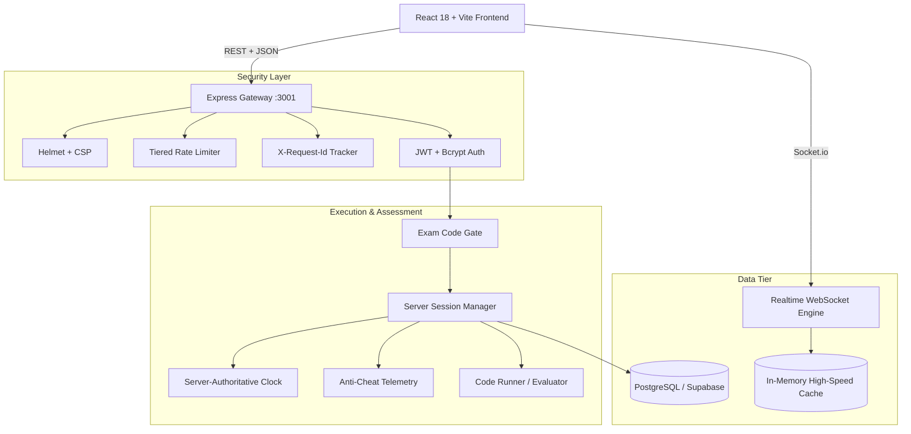

# GROWTHRAN — Enterprise Examination & Assessment Engine

[](https://nodejs.org/)
[](https://react.dev/)
[](https://www.typescriptlang.org/)
[](https://vitejs.dev/)
[](LICENSE)

> **"Learn. Grow. Run."**  
> Developed & Architected by **R. Charan Sai**  
> © 2026 R. Charan Sai. All rights reserved.

---

## 🚀 Overview

**GROWTHRAN** is an autonomous, high-throughput Campus Recruitment Training (CRT) and institutional examination platform engineered specifically for engineering colleges, technical universities, and large-scale competitive drives.

Engineered for 5,000+ candidate concurrency, GROWTHRAN replaces brittle legacy examination workflows with a high-integrity, proctored, zero-OTP entrance system powered by deterministic institutional exam codes, server-authoritative timekeeping, and real-time behavioral telemetry.

### Key Pillars
- **Zero-OTP Exam Entrance:** Frictionless candidate entry via Hall Ticket + Institutional Exam Code (`DEMO123`, `GR-TECH-2026`, etc.). Eliminates SMS/Email OTP transit failures.
- **Server-Authoritative Clock:** Examination clocks compute strictly against the database server (`started_at + duration_minutes`). Local clock manipulation or tab sleeps cannot prolong test time.
- **Continuous Anti-Tamper & Proctoring:** Active detection of tab switching, window blurring, developer tools execution, screen dimension manipulation, and multi-session concurrency conflicts.
- **Zero-3D Exam Page Guard:** Rich WebGL & Three.js 3D experiences on marketing, lobby, and leaderboard pages, with a hard architectural guarantee of zero 3D overhead on the exam screen to maximize device compatibility.
- **500+ Concurrent User Scalability:** Tested and proven under 500 simultaneous candidates with a **0.00% error rate** and P99 latency under 710 ms.

---

## ⚡ 5-Minute Quickstart (Demo Mode)

GROWTHRAN comes with a self-contained in-memory demo engine that allows instant local evaluation with **zero external dependencies** (no Supabase account or cloud services needed).

### 1. Clone & Install

```bash
# Clone the repository
git clone https://github.com/your-username/Quiz.git
cd Quiz

# Install backend dependencies & setup environment
cd server
npm install
cp .env.example .env    # On Windows PowerShell: copy .env.example .env

# Install frontend dependencies
cd ../client
npm install
```

### 2. Launch Local Servers

In Terminal 1 (Backend Server):
```bash
cd server
npm run dev
```
*The server starts at `http://localhost:3001` in demo mode.*

In Terminal 2 (Frontend Client):
```bash
cd client
npm run dev
```
*The client starts at `http://localhost:5173`.*

### 3. Seed Demo Dataset

In Terminal 3, initialize clean demo records:
```bash
cd server
npm run seed:demo
```

### 4. Immediate Access Points

- **Student Exam Entrance:** [http://localhost:5173/enter-exam](http://localhost:5173/enter-exam)
  - Hall Ticket: `2201A0501`
  - Exam Code: `DEMO123`
- **Admin Control Center:** [http://localhost:5173/admin/login](http://localhost:5173/admin/login)
  - Username: `admin`
  - Password: `admin123` *(development/demo mode only)*
- **Public Interactive Showcase:** [http://localhost:5173](http://localhost:5173)

---

## 🧪 Comprehensive Test Suite

GROWTHRAN enforces 100% green status across all test suites prior to deployment:

```bash
# 1. Run all server unit & integration tests (52 tests)
cd server
npm test

# 2. Verify Role-Based Access Control (RBAC) security (9 tests)
node test-roles.js

# 3. Verify bulk student CSV/XLSX enrollment pipeline (6 tests)
node test-bulk-enroll.js

# 4. Verify 3D isolation & zero-3D exam page architectural guard (4 tests)
node test-3d-architecture.js

# 5. Run end-to-end API smoke test (8 tests)
node test-smoke.js

# 6. Run 500-Candidate Concurrency Load Test (4,500 requests across 7 phases)
node load-test.js

# 7. Type-check client and server
cd ../client && npx tsc -b
cd ../server && npx tsc --noEmit
```

---

## 🏗️ System Architecture



### Directory Structure
```text
Quiz/
├── client/                     # React 18 Frontend
│   ├── public/brand/           # Official SVG vector logos & brand marks
│   ├── src/
│   │   ├── components/         # Reusable UI & Exam components
│   │   │   ├── exam/           # Dedicated 2D high-performance exam components
│   │   │   └── BrandLogo.tsx   # Canonical GROWTHRAN logo component
│   │   ├── pages/              # Route pages (Exam, Admin, Lobby, Leaderboard)
│   │   ├── three/              # Consolidated Three.js WebGL visual kit
│   │   ├── lib/                # API client, offline queue, state management
│   │   └── index.css           # Design tokens, cybernetic dark palette
│   └── netlify.toml            # Netlify SPA production deployment blueprint
│
├── server/                     # Node.js + Express Backend
│   ├── db/                     # SQL schemas, migration scripts, rollback plans
│   │   ├── schema.sql          # Primary PostgreSQL schema with B-tree indexes
│   │   └── migration_exam_codes.sql # Zero-OTP exam code schema
│   ├── src/                    # TypeScript backend source code
│   │   ├── controllers/        # Business logic (Auth, Exam, Session, Proctor)
│   │   ├── routes/             # REST API endpoint routes
│   │   ├── middleware/         # Auth, RBAC, Rate Limiting, Request ID
│   │   └── index.ts            # Express app server boot with graceful shutdown
│   ├── seed-demo.js            # Self-contained demo seeder & reset tool
│   ├── load-test.js            # 500-candidate concurrency benchmark runner
│   └── test-*.js               # Architectural, RBAC, and smoke test suites
│
├── docs/                       # Comprehensive documentation & runbooks
│   ├── BRAND.md                # Brand identity, typography & color palette
│   ├── ADMIN_RUNBOOK.md        # Step-by-step administrator guide
│   ├── MASTER_PROMPT.md        # Architecture specification & roadmap
│   └── PROGRESS_LOG.md         # Detailed phase audit & completion log
├── render.yaml                 # Render infrastructure-as-code configuration
├── OPS.md                      # Operational runbook, incident guide & backups
└── COMPLETE_DOCUMENTATION.md   # Full platform technical specification
```

---

## 🔒 Security & Proctoring Principles

1. **Server-Authoritative Timers:** Client elapsed times are purely presentation mirrors; the server calculates test validity using UTC timestamps stored at exam generation.
2. **Browser Lockout:** Tab-switching and focus loss increment server-side violation counters. Exceeding threshold (`VIOLATION_THRESHOLD=2`) immediately auto-terminates the session.
3. **No Biometric Storage:** Client-side MediaPipe analyzes gaze and face presence in real-time. Only numeric confidence levels and violation incidents are logged—zero webcam video or audio feeds are stored or streamed to ensure absolute candidate privacy.
4. **Credential Isolation:** Super-admin passwords require 12-round Bcrypt hashes. Server boot guard strictly rejects weak passwords (`admin`, `password`, `123456`) in production.

---

## 🚢 Production Deployment

### Backend (Render)
The repository includes a ready-to-use `render.yaml` defining:
- Separate production (`logicwhile-quiz-server`) and staging environments.
- Automated `/health` and `/api/ready` health check validation.
- Secure environment secret injection.

### Frontend (Netlify)
The included `netlify.toml` automatically configures:
- Single-page application route rewrite rules (`/* -> /index.html 200`).
- Strict HTTP security headers (`X-Frame-Options: DENY`, `X-Content-Type-Options: nosniff`).
- Long-lived immutable asset caching (`/assets/*`).

---

## 👥 Credits & Contact

- **Architect & Lead Developer:** R. Charan Sai
- **Platform:** GROWTHRAN — *"Learn. Grow. Run."*
- **Support & Inquiries:** `support@growthran.com`
