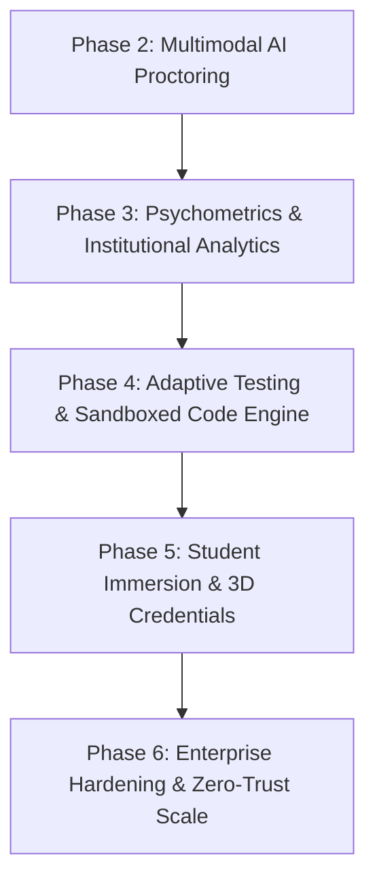

# 🚀 GROWTHRAN: Master Blueprint & Architectural Enhancement Plan
**Product:** GROWTHRAN  
**Tagline:** *"Learn. Grow. Run."*  
**Developer & Architect:** R. Charan Sai  
**Repository Branch:** `upgrade/premium-v4`  
**Target Environment:** Node.js / Express (Port 3001) + React / Vite / Three.js (Port 5173)

---

## Executive Summary

**GROWTHRAN** is an enterprise-grade, high-concurrency assessment, recruitment, and institutional evaluation platform designed to combine uncompromised exam integrity, real-time multimodal AI proctoring, rich 3D visualization, and psychometric intelligence.

This document serves as the single source of truth for:
1. **The Completed Foundation** (Phase R Branding & Identity, Phase 1 Exam Integrity & Anti-Cheat, and 3D Module Integration).
2. **The Planned Enhancements for Every Phase** (Phases 2 through 6), each elevated with modern engineering standards, robust architectural patterns, and visual excellence.
3. **Execution Guardrails** ensuring zero downtime, 100% test coverage, and strict branch safety.

---

## Current Platform State (Completed & Locked)

```
[Phase R: Brand & Identity] ──> [Phase 1: Exam Integrity] ──> [3D Hero Globe] ──> [Phase 2: AI Proctoring]
         (COMPLETE)                       (COMPLETE)                (COMPLETE)             (NEXT IN QUEUE)
```

### ✅ Phase R: Brand, Logo & Identity
- Rebranded all user-facing copy, metadata, and assets to **GROWTHRAN** (*"Learn. Grow. Run."* | *Developed by R. Charan Sai*).
- Integrated official brand SVG & high-res vector assets into header, footer, authentication portals, and certificates.
- Configured backward-compatible dual-prefix certificate verification supporting both new `GR-` and legacy `LW-` hashes.
- Sanitized email templates to use dynamic environment-driven sender configurations (`EMAIL_FROM`, `EMAIL_FROM_NAME`).

### ✅ Phase 1: Exam Integrity & Anti-Cheat Foundation
- **1.1 Fullscreen Enforcement:** 3-strike violation policy, duration calculation, and automated submission upon exhaustion.
- **1.2 Dual-Camera & Screen Share:** Periodic 30-second screen thumbnail streaming and instant violation triggers on screen-share termination.
- **1.3 Web Audio Proctoring:** Real-time RMS decibel threshold monitoring, background noise spike detection, and timestamped violation telemetry.
- **1.4 Offline Resilience & IndexedDB Buffer:** Zero-data-loss client buffer with automated batch flush upon reconnection and `/resume-state` recovery.
- **1.5 Server-Authoritative Timer & Scoring:** 100% server-side answer evaluation, 30-second network grace window, and duplicate submission locks (409 Conflict).

### ✅ 3D Hero Module Integration
- Embedded official high-DPI GROWTHRAN badge into WebGL `CollegeGlobe.tsx`.
- Double-sided equator placement with rounded glassmorphic backdrop (`#081432`), electric blue glowing rim (`#3B82F6`), corner indicators, and internal glowing core (`#1B5FB5`).

---

## Enhanced Master Roadmap: Phase-by-Phase



---

### 🧠 Phase 2: Multimodal AI & Real-Time Proctoring Pipeline

Elevates passive monitoring to intelligent, privacy-first on-device AI computer vision.

#### 2.1 MediaPipe FaceMesh & Multi-Face Detection
- **What it does:** In-browser WebAssembly-accelerated 468-point face mesh.
- **Enhancement:**
  - Detects **Zero Faces** (candidate absent from camera) with a 5-second grace countdown before triggering an integrity strike.
  - Detects **Multiple Faces** (unauthorized third-party assisting) instantly with bounding-box telemetry.
  - Privacy-preserving: No raw video frames sent to the cloud; only encrypted landmark vectors and timestamped event triggers.

#### 2.2 3D Head Pose Estimation & Gaze Deviation
- **What it does:** Calculates 3D Euler angles (Yaw, Pitch, Roll) from facial keypoints (nose tip, chin, eye corners).
- **Enhancement:**
  - Flags sustained horizontal gaze deviation ($> 28^\circ$ yaw for $> 4.5\text{s}$) indicative of looking at a secondary monitor or mobile phone.
  - Flags downward pitch ($< -20^\circ$) indicative of looking down at notes or keyboard devices.
  - Displays a subtle, non-intrusive HUD warning to the candidate before logging an official strike.

#### 2.3 Real-Time Admin Live Monitor Matrix & Timeline
- **What it does:** Unified WebSocket live monitor for invigilators and super admins.
- **Enhancement:**
  - Grid view of active candidates with real-time health pulses (Audio dB meter, Fullscreen status, Screen-share thumbnail, AI flags).
  - Chronological **Violation Timeline**: Invigilator can replay exact timestamps with captured thumbnails.
  - **False-Positive Override Switch:** Allows proctors to review and forgive candidate flags (e.g., student coughed or adjusted eyeglasses).

#### 2.4 Dynamic Integrity Score & Risk Tiering
- **What it does:** Algorithmic calculation of candidate exam credibility ($0 - 100\%$).
- **Enhancement:**
  - Weighted penalty matrix: Fullscreen exit ($-15\%$), Audio spike ($-5\%$), Gaze drift ($-5\%$), Multiple faces ($-25\%$).
  - Instant classification into 4 clear visual tiers:
    - 🟢 **Low Risk (90 - 100%):** Pristine session, fast-track approval.
    - 🟡 **Moderate Risk (75 - 89%):** Minor warnings, optional manual review.
    - 🟠 **High Risk (50 - 74%):** Multiple infractions, flagged for proctor review.
    - 🔴 **Critical Risk (< 50%):** Immediate invalidation or disqualification candidate.

---

### 📊 Phase 3: Psychometrics, Institutional Analytics & Intelligence

Transforms raw test scores into actionable educational and hiring insights.

#### 3.1 Item Discrimination (Point-Biserial $r_{pbis}$) & Question Difficulty ($P$-Value)
- **What it does:** Mathematical evaluation of question quality across cohorts.
- **Enhancement:**
  - Computes difficulty index ($P = \frac{\text{Correct}}{\text{Total}}$) and identifies questions that are too trivial ($P > 0.95$) or defective ($P < 0.15$).
  - Point-Biserial correlation distinguishes whether high-performing students got the question right compared to low-performing students, flagging ambiguous or flawed questions ($r_{pbis} < 0.20$).

#### 3.2 Cognitive Heatmaps (Bloom's Taxonomy) & Skill Radars
- **What it does:** Visual matrix of student mastery across cognitive levels (Remember, Understand, Apply, Analyze, Evaluate).
- **Enhancement:**
  - Interactive 3D Radar Chart breaking down individual and batch strength across Quantitative, Logical, Core CS, and Domain Knowledge.
  - College and Department benchmarking: Compare CSM Batch 2028 against ECE Batch 2028 on specific core concepts.

#### 3.3 Executive Export Suite (PDF & Excel)
- **What it does:** Institutional reports for deans, placement directors, and enterprise recruiters.
- **Enhancement:**
  - Branded executive PDF summaries with official GROWTHRAN seal, performance distribution curves, and cohort rankings.
  - Multi-sheet Excel exports containing raw timestamps, violation logs, question-by-question response matrices, and normalized percentiles.

---

### ⚡ Phase 4: Adaptive Testing & Sandboxed Code Execution

Brings dynamic difficulty adaptation and real-time software development evaluation.

#### 4.1 Computerized Adaptive Testing (CAT / 2-Parameter Item Response Theory)
- **What it does:** Dynamically adjusts test difficulty based on the candidate's real-time accuracy.
- **Enhancement:**
  - Uses the 2PL IRT model ($P(\theta) = \frac{1}{1 + e^{-a(\theta - b)}}$) to estimate student latent ability ($\theta$).
  - Candidates getting questions right receive progressively more challenging, high-yield questions; struggling candidates receive diagnostic questions to pinpoint knowledge gaps.
  - Reduces required test length by $40\%$ while increasing statistical measurement precision.

#### 4.2 Sandboxed Holographic Code Execution Engine
- **What it does:** In-browser and microservice code editor supporting Python, JavaScript, Java, and C++.
- **Enhancement:**
  - Holographic Monaco editor with syntax highlighting, auto-complete, and dark glassmorphic styling.
  - Multi-tier test-case execution: Public test cases (for candidate debugging) + Hidden boundary test cases (for final grading).
  - Time & Memory limits strictly enforced ($< 2.0\text{s}$, $< 256\text{MB}$) with sandbox isolation.

#### 4.3 Automated AI Question Quality & Distractor Audit
- **What it does:** Validates uploaded question banks before publishing an exam.
- **Enhancement:**
  - Analyzes multiple-choice distractors to ensure plausible error traps rather than obvious throwaway choices.
  - Checks for grammar inconsistencies, answer key leakage, and cognitive redundancy.

#### 4.4 Real-Time Code Similarity & Token Matcher
- **What it does:** Evaluates submitted code for unauthorized code sharing or plagiarism.
- **Enhancement:**
  - AST (Abstract Syntax Tree) tokenization immune to variable renaming, whitespace changes, or loop reordering.
  - Generates similarity clusters across candidate submissions for proctor audit.

---

### 🎓 Phase 5: Student Immersion, Career Readiness & 3D Credentials

Drives candidate engagement, career growth, and verifiable credentials.

#### 5.1 Holographic 3D WebGL Credential Pass
- **What it does:** Interactive 3D achievement card awarded to candidates upon exam completion.
- **Enhancement:**
  - Realistic Three.js metallic card with holographic reflection, embossed student details, and official GROWTHRAN stamp.
  - Interactive mouse tilt and gyroscope motion on mobile devices.
  - One-click share to LinkedIn with cryptographically verifiable QR verification route (`/verify/:certificateId`).

#### 5.2 Practice Arena & Peer Code Battles
- **What it does:** Gamified training arena for students outside official exam windows.
- **Enhancement:**
  - Daily coding sprints and aptitude streaks to encourage continuous learning (*"Learn. Grow. Run."*).
  - Real-time 1v1 Peer Challenge Mode matching students of comparable skill tiers.

#### 5.3 AI Career Readiness Index & Mock Technical Interviewer
- **What it does:** Bridges exam performance directly with placement readiness.
- **Enhancement:**
  - Generates a personalized Placement Readiness Score ($0 - 100$) based on coding speed, accuracy, and domain mastery.
  - Provides targeted AI study recommendations: "Strengthen Graph Traversal and OS Memory Management to reach Top 5% Placement Tier."

---

### 🛡️ Phase 6: Enterprise Hardening, Scalability & Zero-Trust Architecture

Ensures high availability, fault tolerance, and compliance for nationwide concurrent exams.

#### 6.1 Cryptographic Audit Trail & Tamper-Evident Event Log
- **What it does:** Every candidate action (keystroke, answer select, violation event) signed with a hash chain.
- **Enhancement:**
  - SHA-256 Merkle-tree event logging: Any retroactive tampering with candidate answers or scores breaks the chain signature.
  - Full audit export for legal compliance and university academic integrity boards.

#### 6.2 Resilient WebSocket Cluster & Heartbeat Auto-Reconnect
- **What it does:** Ensures seamless real-time connection across thousands of simultaneous test-takers.
- **Enhancement:**
  - Exponential backoff reconnection with state synchronization.
  - Dual-mode fallbacks: If WebSockets are blocked by strict campus firewalls, gracefully fall back to HTTP Long-Polling without interrupting the exam.

#### 6.3 Redis Caching & High-Concurrency Throughput
- **What it does:** Handles traffic spikes during simultaneous exam starts (e.g., 5,000+ students clicking "Start Exam" at 10:00:00 AM).
- **Enhancement:**
  - Pre-cached exam question banks and in-memory session validation.
  - Rate limiting on authentication and answer submissions to prevent server degradation.

---

## Design System & Visual Aesthetics Standard

To guarantee a modern, cohesive, and premium experience across every module:

| Design Dimension | Specification |
|---|---|
| **Base Theme** | Deep Cyber Dark (`#030712`, `#081432`, `#0F172A`) with high-contrast text |
| **Brand Primary** | Growth Blue (`#2563EB`, `#3B82F6`) |
| **Accent Glow** | Electric Cyan (`#06B6D4`, `#38BDF8`) |
| **Integrity Indicators** | Emerald (`#10B981`) for Verified, Amber (`#F59E0B`) for Warning, Crimson (`#EF4444`) for Strike |
| **Surfaces** | Glassmorphic cards with subtle backdrop blur (`backdrop-blur-md`), 1px borders (`border-white/10`) |
| **Typography** | Inter & Outfit with clean hierarchy, tabular numbers for timers and rankings |
| **Animations** | Fluid micro-interactions via Framer Motion & Three.js ambient lighting |

---

## Execution Principles & Operational Safety

1. **Strict Branch Hygiene:** All work remains strictly within `upgrade/premium-v4` in `C:\Users\chara\OneDrive\Desktop\Quiz`. No remote pushes.
2. **Atomic Logical Commits:** One commit per feature or bug fix with descriptive messages.
3. **Continuous Regression Testing:** Every commit is validated against the full test suite (Auth 10/10, Gate Spec 10/10, Smoke 8/8, Roles 9/9, Phase 1 Suites 22/22, and both TypeScript builds).
4. **Preservation of Core Assets:** Official logo assets, copyright notices (`© 2026 R. Charan Sai. All rights reserved.`), and dual-certificate compatibility remain permanently intact.
