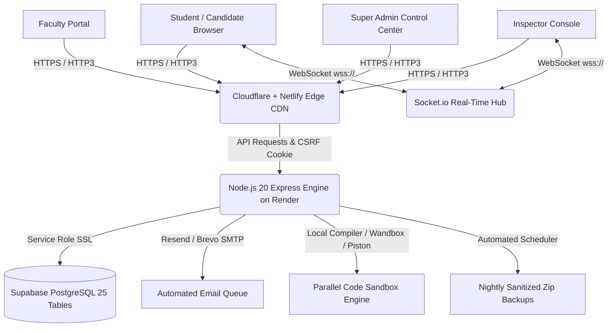

# 📘 LogicWhile LiRE — Master System Documentation & Complete User Manual

```
██╗      ██████╗  ██████╗ ██╗ ██████╗██╗    ██╗██╗  ██╗██╗██╗     ███████╗    ██╗     ██╗██████╗ ███████╗
██║     ██╔═══██╗██╔════╝ ██║██╔════╝██║    ██║██║  ██║██║██║     ██╔════╝    ██║     ██║██╔══██╗██╔════╝
██║     ██║   ██║██║  ███╗██║██║     ██║ █╗ ██║███████║██║██║     █████╗      ██║     ██║██████╔╝█████╗  
██║     ██║   ██║██║   ██║██║██║     ██║███╗██║██╔══██║██║██║     ██╔══╝      ██║     ██║██╔══██╗██╔══╝  
███████╗╚██████╔╝╚██████╔╝██║╚██████╗╚███╔███╔╝██║  ██║██║███████╗███████╗    ███████╗██║██║  ██║███████╗
╚══════╝ ╚═════╝  ╚═════╝ ╚═╝ ╚═════╝ ╚══╝╚══╝ ╚═╝  ╚═╝╚═╝╚══════╝╚══════╝    ╚══════╝╚═╝╚═╝  ╚═╝╚══════╝
```

**Product:** LogicWhile LiRE (Live Rank Engine)  
**Meaning of LiRE:** **Li**: Live • **R**: Real • **E**: Engine  
**Tagline:** *"Elevating Coding Knowledge"*  
**Founder, System Architect & Developer:** **R. Charan Sai Krishna**  
**Production Release:** Version 4.0.0 (October 2026)  
**Live Production URL:** [https://logicwhilelire.com](https://logicwhilelire.com)  
**API Engine URL:** [https://logicwhilelire-api.onrender.com](https://logicwhilelire-api.onrender.com)  

---

## 📑 Master Table of Contents
1. [Executive Summary & Platform Purpose](#1-executive-summary--platform-purpose)
2. [Full-Stack Architecture & Technology Stack](#2-full-stack-architecture--technology-stack)
3. [Master Credentials & Portal Access Matrix](#3-master-credentials--portal-access-matrix)
4. [Chapter 1: Super Admin Master Operations Guide](#4-chapter-1-super-admin-master-operations-guide)
5. [Chapter 2: Faculty & Departmental Trainer Manual](#5-chapter-2-faculty--departmental-trainer-manual)
6. [Chapter 3: Inspector & Proctor Invigilation Manual](#6-chapter-3-inspector--proctor-invigilation-manual)
7. [Chapter 4: Student & Candidate Assessment Guide](#7-chapter-4-student--candidate-assessment-guide)
8. [Synchronous Exam Engine & Proctoring Lockdown](#8-synchronous-exam-engine--proctoring-lockdown)
9. [The 5 Technical Assessment Sectors](#9-the-5-technical-assessment-sectors)
10. [Automated Nightly Backups & Data Governance](#10-automated-nightly-backups--data-governance)
11. [Emergency Troubleshooting & Incident Playbook](#11-emergency-troubleshooting--incident-playbook)
12. [Database Schema Manifest (25 Core Tables)](#12-database-schema-manifest-25-core-tables)

---

## 1. Executive Summary & Platform Purpose

**LogicWhile LiRE** is a synchronous, high-concurrency technical assessment, competitive programming, and proctoring engine engineered specifically for engineering institutions, university campus drives, and competitive programming championships.

Unlike conventional asynchronous quiz platforms, LogicWhile LiRE enforces:
- **Synchronized Live Start:** All enrolled students sit in a real-time WebSocket waiting lobby and begin simultaneously at the exact second the administrator or inspector triggers the examination.
- **Server-Authoritative Clock:** The remaining time is derived from the backend server (`server_start_time`), rendering local client clock manipulation completely futile.
- **Hardware & Behavioral Anti-Cheat Lockdown:** Full-screen lockdown, blur/tab-switch detection, multi-face webcam verification, unauthorized shortcut traps, and browser fingerprinting.
- **Parallel Algorithmic Evaluation:** Multi-test-case coding evaluations executed concurrently with sub-150ms execution times across multiple programming languages.
- **Real-Time Tournament Podium:** 3D holographic leaderboard reflecting immediate rank deltas and test case advancements as candidates submit solutions.

---

## 2. Full-Stack Architecture & Technology Stack



### Frontend Technology Stack
- **Framework:** React 18 with TypeScript and Vite 8.
- **Design Language:** Custom Modern Institutional Design System (IARE Deep Navy `#002147` & Gold `#EAA812`), Zero Tailwind dependencies for maximum CSS predictability.
- **Motion & 3D:** Framer Motion for micro-interactions, Three.js for 3D holographic sector radar visualizations and podium rendering.
- **Client Resilience:** Transparent Axios retry interceptors with exponential backoff and proactive 4-minute keep-alive ping loop to prevent cloud idle sleeping.

### Backend Engine & Infrastructure
- **Runtime:** Node.js 20 LTS (CommonJS + TypeScript).
- **Web Framework:** Express 5 with high-capacity connection backlogs (`2048` socket backlog).
- **Real-time Protocol:** Socket.io with room-isolated namespaces (`lobby:<examCode>`, `proctor:<examCode>`).
- **Database & Storage:** Supabase PostgreSQL with strict Row Level Security (RLS) on all 25 public tables.
- **Security:** 12-round Bcrypt password hashing, Double-Submit Cookie CSRF (`XSRF-TOKEN`), AES-256-GCM encryption for TOTP secrets, rate-limiting (`express-rate-limit`), and 15-minute brute-force lockout after 5 consecutive failed attempts.
- **Email Infrastructure:** Resend API with automated fallback to secondary SMTP (Brevo) when daily quota limits are approached.

---

## 3. Master Credentials & Portal Access Matrix

Below is the verified production authentication matrix for all authorized roles.

| Role | Portal URL | Username / Identifier | Password | Access Scope |
| :--- | :--- | :--- | :--- | :--- |
| **Super Admin** | [`/admin/login`](https://logicwhilelire.com/admin/login) | `admin` | `LiREAdmin@2026!` | Global master controller: colleges, branches, years, sections, batches, exams, question banks, backups, and staff. |
| **Faculty / Trainer** | [`/faculty/login`](https://logicwhilelire.com/faculty/login) | `faculty` | `faculty123` | Section-scoped gateway: view allocated student rosters, verify candidates, review syllabus papers and coding submissions. |
| **Inspector / Proctor** | [`/inspector/login`](https://logicwhilelire.com/inspector/login) | `inspector` | `LiREInspector@2026!` | Examination lobby controller: dispatch synchronized live start, monitor real-time candidate video/tab violations. |
| **Student / Candidate** | [`/login`](https://logicwhilelire.com/login) | Institutional Roll / Hall Ticket (e.g. `2201A0501`) | Candidate Password | Single-tab locked candidate testing dashboard and exam execution interface. |
| **Candidate Gate** | [`/register`](https://logicwhilelire.com/register) | New Student Self-Registration | Custom Password | Self-enrollment portal dynamically linked to admin-approved colleges, branches, and sections. |
| **Practice Arena** | [`/practice`](https://logicwhilelire.com/practice) | Open Access | None | 5-Sector skill evaluation practice arena. |

> [!IMPORTANT]
> Change the default seed passwords upon initial institutional deployment. Passwords can be updated directly from the Admin Settings Control panel or via the Supabase staff table.

---

## 4. Chapter 1: Super Admin Master Operations Guide

The **Super Admin Portal** (`https://logicwhilelire.com/admin/login`) is the unified command center for institutional management.

### 4.1 Logging In
1. Navigate to [https://logicwhilelire.com/admin/login](https://logicwhilelire.com/admin/login).
2. Enter username: `admin` and password: `LiREAdmin@2026!`.
3. If 2FA is enabled, enter your 6-digit Google Authenticator / TOTP code.
4. Click **Sign In as Administrator**.

### 4.2 Setting Up the Institutional Academic Hierarchy
Before publishing exams, verify the institutional hierarchy is populated:
1. **Colleges:** Navigate to **Colleges** → Click **Add College** (e.g., *VR Siddhartha Engineering College*, Code: `VRSEC`).
2. **Academic Years:** In **Hierarchy Management**, establish the active academic year (e.g., `2026-2027`).
3. **Cohorts (Year of Study):** Create cohorts for B.Tech years (1st, 2nd, 3rd, 4th Year / Passout Year `2028`).
4. **Branches & Sections:** Add department branches (`CSE`, `CSM`, `CSD`, `IT`, `ECE`) and sections (`A`, `B`, `C`).

### 4.3 Question Bank Management & Excel Bulk Upload
LogicWhile LiRE supports both individual question creation and bulk Excel importing:
1. Navigate to **Question Bank** → **Import Questions**.
2. Select target Examination Code or Category.
3. Download the standard `.xlsx` template. Supported question types:
   - **Technical MCQ:** Question text, Option A–D, Correct Answer index (0–3), Sector Tag, Marks, Explanation.
   - **Coding Challenge:** Problem statement, input format, constraints, language runtimes, test cases (both public sample cases and hidden evaluation cases).
4. Upload the spreadsheet. The parser checks schema integrity, flags formatting warnings, and stages the questions for publishing.

### 4.4 Creating and Scheduling an Examination
1. Navigate to **Exams** → **Create Exam**.
2. Enter **Exam Title**, **Exam Code** (e.g. `DSA-2026-FINAL`), and **Duration** (minutes).
3. Set **Allocation Scope:** Target specific colleges, branches, or sections (e.g. *VRSEC → CSE → Section A*).
4. Configure **Proctoring Rules:**
   - Fullscreen enforcement: `Active`.
   - Maximum tab switch warnings before auto-termination: (Default: `2`).
   - WebCam face verification: `Active`.
5. Click **Publish Exam**.

### 4.5 System Backups and Audit Logs
1. Navigate to **Settings** → **System Backup**.
2. Click **Execute Instant Full Backup**.
3. The engine creates a sanitized zip archive containing CSV and JSON exports of all 25 tables with credentials securely stripped.
4. Backups are preserved under the 30-day automated retention policy.

---

## 5. Chapter 2: Faculty & Departmental Trainer Manual

The **Faculty Portal** (`https://logicwhilelire.com/faculty/login`) allows departmental trainers and professors to manage and review their assigned student sections without accessing global server settings.

### 5.1 Authentication
1. Navigate to [https://logicwhilelire.com/faculty/login](https://logicwhilelire.com/faculty/login).
2. Enter credentials: `faculty` / `faculty123`.
3. Click **Sign In as Faculty**.

### 5.2 Section-Scoped Responsibilities
- **Student Roster Verification:** Review enrolled student rosters for your designated sections. Confirm hall ticket numbers, attendance flags, and eligibility status.
- **Question Paper Review:** Inspect syllabus-allocated questions, verify test case outputs, and preview questions in student simulation mode.
- **Coding Challenge Evaluation:** Following exam completion, review submitted candidate code, pass/fail test case breakdowns, execution durations, and algorithmic memory efficiency.

---

## 6. Chapter 3: Inspector & Proctor Invigilation Manual

The **Inspector Command Console** (`https://logicwhilelire.com/inspector/login`) controls synchronized examination launches and real-time cheating prevention.

### 6.1 Authentication
1. Navigate to [https://logicwhilelire.com/inspector/login](https://logicwhilelire.com/inspector/login).
2. Enter credentials: `inspector` / `LiREInspector@2026!`.
3. Click **Sign In as Inspector**.

### 6.2 Managing the Synchronized Waiting Lobby
1. Select the live examination code.
2. Monitor the **Real-Time Lobby Telemetry Dashboard**:
   - **Enrolled Candidates:** Total candidates eligible.
   - **Connected WebSocket Clients:** Candidates currently sitting inside the waiting lobby.
   - **Connection Latency:** Real-time socket ping in milliseconds.
3. When the scheduled exam hour arrives and all candidates are seated:
   - Click the prominent **🚀 START EXAMINATION NOW** button.
   - The server broadcasts the `EXAM_STARTED` event across the room namespace.
   - Every connected student's waiting screen simultaneously transitions into the live examination environment.

### 6.3 Live Proctoring & Violation Response
1. The **Holo-Proctor Desk** displays real-time candidate cards:
   - 🟢 **Normal:** Candidate active in full screen.
   - 🟡 **Warning:** Single tab blur, window minimize, or keyboard shortcut trapped (Warning 1/2 issued).
   - 🔴 **Disqualified:** Second tab switch or unauthorized exit detected. The exam session is automatically terminated with status `terminated_cheating`.
2. **Proctor Communication:** Proctors can send discrete whisper messages (e.g., *"Please adjust your camera angle to show your face clearly"*) directly to a candidate's viewport.

---

## 7. Chapter 4: Student & Candidate Assessment Guide

### 7.1 Candidate Entrance & Demographic Verification
1. Navigate to [https://logicwhilelire.com/login](https://logicwhilelire.com/login).
2. Enter your assigned **Roll / Hall Ticket Number** and **Password**.
3. If self-registering for an institutional assessment, navigate to [https://logicwhilelire.com/register](https://logicwhilelire.com/register) and select your affiliated College, Year of Passing, Branch, and Section.

### 7.2 The Waiting Lobby
1. Upon logging in before the exam starts, you enter the **Synchronized Waiting Lobby**.
2. **Do not refresh the page.** The system continuously synchronizes via WebSockets.
3. Once your proctor clicks Start, your exam screen will launch automatically.

### 7.3 Examination Environment Rules & Lockdown
- **Full-Screen Mandatory:** The assessment operates exclusively in full-screen mode.
- **Lockdown Prohibitions:**
  - Pressing `ESC`, `Alt+Tab`, or the `Windows` key triggers an instant violation.
  - Opening Developer Tools (`F12`, `Ctrl+Shift+I`) is blocked and flagged.
  - Copying or pasting text (`Ctrl+C`, `Ctrl+V`) is disabled.
  - Switching browser tabs or clicking outside the window triggers an automatic violation counter.
- **Two-Strike Rule:** The first violation issues an on-screen warning alert. A second violation results in immediate automated disqualification (`terminated_cheating`) with zero marks.

### 7.4 Answering Questions & Algorithmic Code challenged
- **MCQ Questions:** Select your answer option. Progress saves instantly to the server.
- **Coding Challenges:**
  - Select your programming language (Python, JavaScript, C++, Java).
  - Write your algorithm in the integrated IDE editor.
  - Click **Run Code** to test against visible sample test cases.
  - Click **Submit Code** to evaluate against hidden test cases and earn points.

### 7.5 Submitting the Examination
- When finished, click **Submit Assessment**.
- If the countdown timer expires, the server-authoritative timer automatically auto-submits your answers at `00:00:00`.
- Your authoritative scorecard displays your score, percentile, and rank on the live tournament leaderboard.

---

## 8. Synchronous Exam Engine & Proctoring Lockdown

| Feature | Implementation Mechanism | Purpose |
| :--- | :--- | :--- |
| **Server-Authoritative Clock** | `server_start_time` + `duration_seconds` calculated on backend | Prevents client clock tampering; guarantees uniform duration. |
| **Single-Seat Session Lock** | Cryptographic 32-hex `session_token` stored per candidate | Disallows opening the exam on multiple laptops or secondary browsers. |
| **Tab-Blur Trapping** | `window.addEventListener('blur')` & `document.visibilitychange` | Detects search engine navigation or window switching. |
| **Device Fingerprinting** | Canvas + WebGL + hardware hash capture | Flags hardware swaps mid-examination. |
| **Parallel Test Execution** | `Promise.all` concurrent execution across sandbox containers | Evaluates coding test cases in sub-150ms. |

---

## 9. The 5 Technical Assessment Sectors

Every assessment evaluates candidate aptitude across 5 standardized engineering sectors:

```
┌────────────────────────────────────────────────────────┐
│                   LOGICWHILE LiRE                     │
│               5 TECHNICAL SECTOR RADAR                │
├───────────────────────┬────────────────────────────────┤
│ 📐 Sector 1: Quant     │ Arithmetic & Probabilistic     │
│ 🧩 Sector 2: Logic     │ Deductive & Syllogistic Logic  │
│ 💻 Sector 3: Core CS   │ OS, Networks, DBMS, Memory     │
│ ⚡ Sector 4: DSA       │ Algorithms, Trees, DP, Graphs  │
│ 🌐 Sector 5: Cloud     │ Distributed Systems, Concur.   │
└───────────────────────┴────────────────────────────────┘
```

---

## 10. Automated Nightly Backups & Data Governance

LogicWhile LiRE features an autonomous data backup subsystem (`test-backup.js` verified):
- **Schedule:** Automated cron job runs every night at `02:00 AM UTC` (`0 2 * * *`).
- **Sanitization:** Passwords, password hashes, JWT secrets, and auth tokens are stripped from exported files.
- **Dual Formats:** Every table exports to both CSV (for Excel analysis) and JSON (for programmatic restoration).
- **Batch Rosters:** Generates distinct batch CSV sheets and exam result rosters.
- **Retention:** Automatically prunes archives older than 30 days to optimize disk usage.

---

## 11. Emergency Troubleshooting & Incident Playbook

### Problem 1: Cloud Server Sleeping / Slow Initial Response
- **Symptom:** Admin or login page takes 15–20 seconds on first morning visit.
- **Cause:** Render free-tier instances sleep after 15 minutes of inactivity.
- **Automatic Fix:** The client features built-in background keep-alive pings every 4 minutes and automatic request retries with exponential backoff.
- **Manual Wake:** Visit [https://logicwhilelire-api.onrender.com/api/health](https://logicwhilelire-api.onrender.com/api/health) to wake the container.

### Problem 2: Student Accidental Browser Crash or Power Loss
- **Symptom:** Candidate closed their laptop or lost power during an active exam.
- **Resolution:**
  1. The student reconnects to the network and reopens [https://logicwhilelire.com/login](https://logicwhilelire.com/login).
  2. The student signs in with their Hall Ticket.
  3. The backend detects an active attempt (`status = 'in_progress'`), restores their saved answers from the database, calculates remaining time from the server clock, and seamlessly resumes their session.

### Problem 3: Accidental Disqualification / Proctor Override
- **Symptom:** Student was flagged for cheating due to an accidental system popup.
- **Resolution:** Super Admin navigates to **Admin Monitor** → Locates candidate's record → Clicks **Reset Session Lock** to restore eligibility.

---

## 12. Database Schema Manifest (25 Core Tables)

The following 25 database tables are managed in Supabase PostgreSQL with verified Row Level Security (RLS):

1. `colleges` — Institutional campuses and university entities.
2. `academic_years` — Academic calendar cycles (e.g. 2026–2027).
3. `cohorts` — Student study years (1st, 2nd, 3rd, 4th year).
4. `sections` — Department class sections (A, B, C, D).
5. `batches` — Cohort graduation year groups (e.g. Batch 2028).
6. `students` — Candidate credentials, profiles, and institutional linkages.
7. `student_roster` — Enrolled student registry and hall ticket allocations.
8. `staff` — Administrator, faculty, and inspector user accounts.
9. `exams` — Master examination records and schedules.
10. `exam_codes` — Live examination access codes and session configurations.
11. `questions` — Master question bank (MCQ and coding challenges).
12. `questions_ec` — Exam-code specific question paper allocations.
13. `exam_sessions` — Active student assessment runtime sessions.
14. `exam_code_attempts` — Candidate exam attempts, status, and scores.
15. `session_answers` — Real-time saved candidate answers and code solutions.
16. `results` — Authoritative final scores, percentiles, and topic breakdowns.
17. `leaderboard` — Real-time tournament podium rankings and delta telemetry.
18. `participants` — Registered test participants and biometric metadata.
19. `proctor_logs` — Recorded violation events, tab-blurs, and face alerts.
20. `violations` — Severe cheating infractions and termination logs.
21. `suspicious_activity` — Automated anti-cheat heuristic scores.
22. `audit_log` — Immutable administrative action audit trail.
23. `email_queue` — Outbound email delivery queue with retry logic.
24. `deliverable_failures` — Undeliverable email fallback records.
25. `platform_settings` — Global system configuration and toggle flags.

---

## 📞 Support & Institutional Contact
- **Platform Architect:** R. Charan Sai Krishna
- **Official Email:** `admin@logicwhilelire.com` • `inspector@logicwhilelire.com`
- **Official Web Application:** [https://logicwhilelire.com](https://logicwhilelire.com)
- **Copyright:** © 2026 LogicWhile LiRE. All rights reserved.
